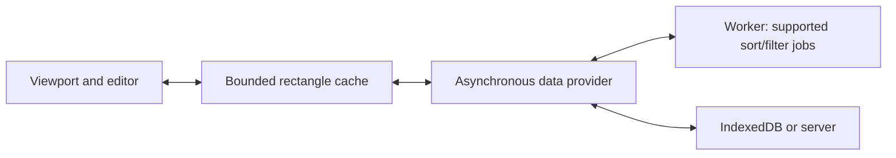

# Large-grid performance: geometry, rendering and data execution

Status: proposed stage-4 design, with a production-build baseline. No production implementation in this change.
Baseline: `0b72f018c673edae3d11a633d483324dcd342f83` (`main`). Pending performance PRs are not included.

## Objective and limits

Make ordinary scrolling, navigation and editing depend on the visible rectangle and a bounded buffer rather
than the sheet's total dimensions. A million rows, thousands of columns and a million fully populated rows
times thousands of columns are different workloads. Virtual rendering alone cannot make the last workload
cheap to store, import or sort.

The proposed **target**, not a measured result, is 2–4ms p95 of main-thread grid work per warm scroll step for
the controlled fixed-size, plain-cell viewport below. End-to-end presentation must fit the refresh interval
(about 16.7ms at 60Hz, 8.3ms at 120Hz). Targets need separate budgets for rich cells, frozen panes, wrapped text
and supported devices; arbitrary user callbacks cannot have a universal engine latency guarantee.

Cold import and uncached global sort remain proportional to data examined. Moving a sort off the main thread
can preserve interaction responsiveness without making the sort itself finish in a few milliseconds. Report
completion time, input responsiveness and memory independently. Do not claim an instant operation by timing
only scheduling, ignoring map installation, or showing the previous data as the completed result.

## Public evidence and comparison method

Only public behavior, documentation and engineering articles inform this comparison. No competitor
implementation, tests or assets are incorporated.

- [Syncfusion documents row and column virtualization](https://ej2.syncfusion.com/javascript/documentation/grid/scrolling/virtual-scrolling):
  rendering follows the viewport. Its documented row-virtualization restrictions include variable template
  heights and cell selection, while column virtualization has additional feature restrictions. A restricted
  grid demonstration is not evidence that an editable spreadsheet with more features has the same cost.
- [DHTMLX Grid documents dynamic loading](https://docs.dhtmlx.com/suite/grid/data_loading/#dynamic-loading),
  including the restriction that its local collection sort does not work until all data is loaded. This is
  evidence for Grid, not an assertion about DHTMLX Spreadsheet's internals. Loading only a window and sorting
  the entire collection are separate problems.
- [AG Grid documents browser scroll-height limits](https://www.ag-grid.com/javascript-data-grid/massive-row-count/).
  Limits vary by browser/version; a large logical sheet eventually needs a logical-to-physical scroll mapping
  or explicit segmented navigation. Do not hard-code a vendor article's pixel limit.
- [The V8 team describes the Google Sheets calculation engine's WasmGC migration](https://v8.dev/blog/wasm-gc-porting).
  This concerns calculation execution; it does not establish that switching our renderer to Wasm or canvas
  improves scrolling. No claim about that product's private rendering architecture is made here.
- [Browser layout guidance](https://web.dev/articles/avoid-large-complex-layouts-and-layout-thrashing)
  explains why geometry reads after DOM/style writes can force synchronous layout. Trace attribution is needed
  before blaming a particular read in our code.

For a fair interactive comparison, match viewport pixels, visible cells, buffer, dimensions in **both axes**,
data representation, renderer complexity, sizing, frozen panes and feature set. Record DOM count, dataset
generation, synchronous constructor, first useful presentation, interaction completion and memory definitions.
Vendor dashboard counters are not comparable until their timing boundaries are known. This document makes
no measured cross-product ranking.

## Reproducible baseline

See [the runner and commands](../../tools/performance/scalability.md). Measurements use the minified production
full bundle, Chromium `156.0.8078.4`, Node `24.21.0`, Intel Core i7-14700KF, Docker, device scale factor 1 and no
CPU throttling. Browser viewport: 1200 × 1000; grid: 1000 × 600; rows: 23px; columns: 80px. Numeric column
definitions, row/column headers and sorting are enabled; automatic sizing and frozen panes are disabled.
Sorting enables deferred source-change observation when its setting is left unspecified; this behavior remains
enabled in this baseline. Input data and schema generation are outside timed operations. Run one warm-up and
five measured fresh-page trials per case, with 30 diagonal steps at the bottom-right per trial.

Production bundle SHA-256: `2a3a78727b5269108b8f8b2b7182d5f9650814d9baae815e7b1c9fe5cc84754a`.

| Rows × logical columns | Constructor median, ms | Scroll frame-gap p50 / p95, ms | Numeric sort synchronous median, ms |
| --- | ---: | ---: | ---: |
| 100 × 20 | 38.0 | 16.7 / 16.7 | 8.8 |
| 10,000 × 20 | 47.0 | 16.7 / 16.7 | 23.0 |
| 100,000 × 20 | 136.2 | 16.7 / 33.4 | 170.6 |
| 1,000,000 × 20 | 974.7 | 83.3 / 133.3 | 2599.3 |
| 100 × 5,000 | 64.5 | 33.3 / 33.4 | 6.6 |
| 10,000 × 200 | 44.9 | 16.7 / 33.3 | 19.4 |
| 100,000 × 5,000, sparse source | 158.0 | 33.3 / 50.0 | 127.4 |

Sparse means 20 populated object properties per row and an explicit 5,000-column schema, not 500 million stored
values. All seven cases reached the last row and column and had **444 DOM body cells at the bottom-right**.
The million-row frame-gap maximum was 450.0ms; it must not be hidden by reporting only a median or average FPS.
Frame percentiles pool 150 intervals per case. At 60Hz, 16.7ms is the scheduling floor, not the cost of a render.
The small case can reach the top/left boundary during the sequence; it is a compatibility/control workload,
not a claim of identical work to a deep scroll on a large sheet. Five trials are an investigative baseline,
not a machine-independent performance guarantee.

For the scroll sequence, median CDP script duration divided by its 31 mutations was approximately 1.59ms
(small), 8.23ms (100k rows), 95.55ms (1m rows), and 18.18ms (wide). Layout duration per mutation was approximately
0.87, 1.09, 0.99 and 3.63ms respectively. These overlapping CDP counters include harness activity and are
diagnostic averages, not per-frame attribution. They support investigating JavaScript before a wholesale
renderer replacement, especially in the million-row case.

The constructor includes its synchronous initial rendering; it is not first-paint time. Sort includes key
extraction, sorting, index-map installation, hooks and synchronous rendering. Million-row sort samples ranged
from 2555.8 to 2661.1ms. Only numeric sorting was measured: date/time costs below remain hypotheses. These are
baseline numbers, **not before/after improvement claims**. Rebaseline after the queued data-operation work is
merged before implementing a stage-4 optimization.

## Diagnostic attribution

A separate precise-coverage run (no reported timings) confirmed the size-query scaling. For a midpoint-to-bottom
jump, the master table made 374, 30,074, 300,074 and **3,000,074 row-height calls** for the 100/10k/100k/1m-row
cases. Across table method invocations, V8 recorded **3,000,111** `Table.getRowHeight` calls and the same
`Core.getRowHeight` count in the million-row case. These are two layers of the same requests; do not add them. The wide case made **15,024 master column-width calls** for that jump. Each axis calculator
ran three times. At the million-row midpoint, two additional top-overlay range-sum calls contributed to a total
of 3,500,119 master row-height queries. These are calls, not unique rows or DOM measurements.

Independent CPU sampling, without coverage or wrappers, attributed about 1.95s of the million-row continuous
scroll profile's 3.05s profile wall time to calculator ancestry. Another large sampled path was row-count
validation through `DataMap.getLength` and `rangeEach`. In the wide profile, `Core.getCellMeta` alone accounted
for about 231ms self time and `_getColWidthFromSettings` for about 115ms over the scroll sequence: width lookup
currently asks for row-zero cell meta even for offscreen columns. In the million-row sort profile,
`rootComparator` accounted for about 1.65s self time. Sample timestamps are sorted before dwell-time aggregation because raw CPU time deltas can be negative. These single investigative profiles guide attribution;
the uninstrumented five-trial results remain the timing baseline.

The million-row interaction trace (jumps, continuous scroll and numeric sort together) contained 369 `MinorGC`
events totaling approximately 310.6ms, with the longest about 18.5ms. This supports investigating allocation
pressure; it does not prove any particular allocation caused the 450.0ms uninstrumented frame outlier.
Layout and paint events are also present. Do not sum nested trace events or assign all `(program)` CPU samples
to the grid's JavaScript.

A five-trial configuration control with `observeChanges: false` still had a 116.7ms scroll frame-gap p95 and
a 2601.3ms median synchronous sort in the million-row case. The small and wide controls also ran. This was a
sequential configuration comparison, not a source optimization or an order-balanced equivalence test; it
demonstrates that turning off observation does not resolve the main scalability problem. It also changes the
external-mutation feature contract. Keep observation costs separate from geometry and sort-comparison costs.

The separate forced-GC diagnostic records input/schema, initialized, post-scroll and two destruction checkpoints.
Some post-destruction deltas relative to the pre-construction data checkpoint are negative. They cannot be
interpreted as negative engine memory: heap representation, collection and warmed-code state change between
checkpoints. These snapshots are diagnostic data, not a leak verdict or a reliable per-cell storage constant.
Longer repeated lifecycles and retained-object analysis remain required.

## Highest-cost paths and ranked candidates

Priorities describe expected user impact. "Confirmed" means measured work/scaling in the stated scenario;
it does not establish the speed-up of an unimplemented alternative. P1 marks substantial scalability work; assign P0 only against an agreed blocking workload or release criterion.

| Rank / priority | Source and function | Current work / suspected problem | Proposal and expected benefit | Risks / required benchmark | Verification |
| --- | --- | --- | --- | --- | --- |
| 1 / P1 | [viewportRows.ts:87](../../packages/sheet/src/3rdparty/walkontable/src/calculator/viewportRows.ts#L87), `calculate`; [viewportColumns.ts:103](../../packages/sheet/src/3rdparty/walkontable/src/calculator/viewportColumns.ts#L103), `calculate` | Start from index zero, call the size getter for every preceding item, allocate `startPositions`; repeated calculators for render/visibility. Cost grows with scroll depth despite bounded DOM. | Shared geometry index; safe constant-size arithmetic where eligible; indexed prefix/range sums for known variable sizes. Eliminate repeated prefix walks and temporary prefix arrays. | Mutable callbacks, hidden/moved items, exact boundary rounding, oversized cells, stretch and hook behavior. Small/deep/wide/variable-size scroll and call-count profiles. | Linear scans confirmed statically; large-case JavaScript scaling measured. Candidate speed-up unmeasured. |
| 2 / P1 | [top.ts:118](../../packages/sheet/src/3rdparty/walkontable/src/overlay/top.ts#L118), [bottom.ts:123](../../packages/sheet/src/3rdparty/walkontable/src/overlay/bottom.ts#L123), [left.ts:114](../../packages/sheet/src/3rdparty/walkontable/src/overlay/left.ts#L114), `sumCellSizes` | Repeated range walks to compute offsets and total sizes, alongside viewport calculations. | Reuse the same geometry snapshot as rank 1 so cloned regions agree and total/range queries avoid scanning. | Independent caches could misalign panes. Measure with 0/1/multiple frozen rows and columns, both headers, nested scroll containers. | Loops confirmed statically; timing attribution requires profiles. |
| 3 / P1 | [columnSorting.ts:492](../../packages/sheet/src/plugins/columnSorting/columnSorting.ts#L492), `sortByPresetSortStates`; [rootComparator.ts:14](../../packages/sheet/src/plugins/columnSorting/rootComparator.ts#L14), `rootComparator`; [date.ts:11](../../packages/sheet/src/plugins/columnSorting/sortFunction/date.ts#L11), `temporalCompareFunctionFactory` | Read all sort keys synchronously, allocate row/key tuples; comparator rest arrays and factory calls per comparison; temporal values parsed repeatedly. | Prepare built-in keys once per sort; avoid per-comparison temporary structures only where semantics match; keep row identity permutation. Fewer repeated computations/allocations. | Factory callbacks may be stateful; invalid temporal values can have unusual ordering. Keep custom path intact, pin current empty/invalid/equal ordering and callback counts. Numeric/date/time before/after, small and large, plus GC trace. | 1m numeric sort blocks ~2.6s in this configuration; individual comparator alternatives and temporal gains unmeasured. |
| 4 / P1 | [dataMap.ts:721](../../packages/sheet/src/dataMap.ts#L721), `getLength`; [columnSorting.ts:579](../../packages/sheet/src/plugins/columnSorting/columnSorting.ts#L579), `enableObserveChangesPlugin`; [dataObserver.ts:44](../../packages/sheet/src/plugins/observeChanges/dataObserver.ts#L44), `setObservedData` | Active row-translation hooks trigger full row-count validation; a timer clears the length cache. Sorting can also enable observation of external source mutation, which mirrors/checks source data. These costs can run around a scroll or sort. | Attribute these paths separately; use mutation/version-based counts and notifications in a supported managed-data path while retaining compatibility for unobservable external mutations. | A permutation preserves cardinality but arbitrary user hooks can hide rows or have side effects. External writes must still be detected when promised. Measure idle CPU, initial deferred work, direct-array mutation, filtering, sort and scroll with observation on/off. | Count-validation CPU samples and deferred observation confirmed. Disabling observation is a feature/configuration change, not an equivalent optimization. |
| 5 / P1 | [tableRenderer.ts:385](../../packages/sheet/src/3rdparty/walkontable/src/tableRenderer.ts#L385), `renderCells`; [tableRenderer.ts:414](../../packages/sheet/src/3rdparty/walkontable/src/tableRenderer.ts#L414), `adjustColumnWidths`; [overlays.ts](../../packages/sheet/src/3rdparty/walkontable/src/overlays.ts), sizing/refresh | DOM/style mutations and geometry reads exist across renderer and overlays; synchronous layout can occur after writes. | Separate geometry reads, one frame's computation and DOM writes where ordering permits; share measurements within that transaction. | Some measurements require newly rendered content. Preserve a bounded corrective measurement phase and callback timing. Browser trace with forced-layout attribution, wrapping and frozen panes. | Layout work measured; a particular forced-layout call site is not yet established. |
| 6 / P1 | [core.ts:3011](../../packages/sheet/src/core.ts#L3011), `_getColWidthFromSettings`; [core.ts:2581](../../packages/sheet/src/core.ts#L2581), `getCellMeta` | Width lookup resolves row-zero cell meta, including translations, settings and hooks, for columns visited by geometry scans. Accessed meta objects remain live. | First remove redundant geometry queries. Then investigate a settings-only width path only where cell-specific settings/hooks cannot affect the result; bound internal derived caches separately from persistent user meta. | Live meta identity/mutations, `cells`, meta hooks and width overrides are observable. Preserve fallback and callback semantics; benchmark deep horizontal scrolling, settings changes and retained objects. | Wide-scroll CPU profile shows ~231ms self time in `getCellMeta`; safe width fast-path benefit unmeasured. Meta is already lazy on access; do not silently evict it. |
| 7 / P1 | [tableRenderer.ts:385](../../packages/sheet/src/3rdparty/walkontable/src/tableRenderer.ts#L385), `renderCells` | Existing nodes are reused, but a full pass clears attributes and invokes every rendered cell renderer. Moving one row can rebind the rectangle. | Investigate retaining overlapping row/cell bindings and updating entering cells. Keep selection/editor overlays separate from content where possible. | Renderer/after-render callback side effects, DOM identity, listeners and editing lifecycle. Skipping callbacks is not a behavior-preserving refactor; any changed invocation contract needs a separate opt-in design. | Hypothesis; no claim that DOM rows are currently recreated on every scroll. |
| 8 / P1 | [autoRowSize.ts:171](../../packages/sheet/src/plugins/autoRowSize/autoRowSize.ts#L171), row sizing; [autoColumnSize.ts:198](../../packages/sheet/src/plugins/autoColumnSize/autoColumnSize.ts#L198), column sizing | Content sizing samples and measures data beyond the immediate visible rectangle. Exact content sizes can require inspecting offscreen cells. | Version measurement results; prioritize visible/nearby regions, budget background work, preserve scroll anchor when estimates change. | Fonts/themes, merged cells, wrapping, late images and custom renderers invalidate dimensions. Defaults must not silently become approximate. Add exact/estimated sizing scenarios. | Hypothesis; deliberately disabled in the current baseline. |
| 9 / P1 | [columnSorting.ts:492](../../packages/sheet/src/plugins/columnSorting/columnSorting.ts#L492), execution; [dataSource.ts:25](../../packages/sheet/src/dataSource.ts#L25), storage; [dataSource.ts:115](../../packages/sheet/src/dataSource.ts#L115), `getAtCell` | Whole-source JS storage plus synchronous full-data work does not provide a bounded-memory or responsive-compute path for huge dense datasets. | Optional rectangular provider/cache and Worker-owned supported keys; sort/filter at the data owner and return a versioned row-ID permutation. Include serialization and main-thread commit costs. | Arbitrary callbacks, synchronous APIs, full-data export, undo/redo, stale jobs and edits during work require explicit capability boundaries. Cold/warm fetch, rapid scrolling, small/large sort, peak memory and cache budget tests. | Architecture gap confirmed; no provider/Worker implementation or gain claimed. |
| 10 / P2 | [overlays.ts](../../packages/sheet/src/3rdparty/walkontable/src/overlays.ts), scroll positioning; [viewport.ts](../../packages/sheet/src/3rdparty/walkontable/src/viewport.ts), viewport calculation | Native element dimensions have finite limits; a logical million-row sheet at larger heights can exceed them. | Probe browser limits and design segmented/rebased logical scroll coordinates with anchor preservation if required. | Thumb/trackpad semantics, zoom, fractional pixels, RTL, accessibility and programmatic navigation. Test first/last row and column in Chromium, Firefox and WebKit. | Documented browser risk; the current Chromium/23px scenarios reached their last cells. Not a confirmed current bug. |

Replacing `forEach` with `for`, replacing small ordered arrays with `Set`, or rewriting into Wasm is not a
separate priority without profiling evidence. Isolated loop/membership/allocation microbenchmarks can compare
equivalent alternatives, but acceptance depends on browser scenarios and compatibility tests.

## First implementation proposal: a shared geometry index

Start with fixed-size row geometry and its overlay range queries, then expand to columns and variable sizes in
separate measured PRs. This is an independent design for our code, using standard indexing algorithms.

1. **Define one internal geometry contract per axis.** Queries are item offset, item at pixel offset, range sum
   and total size, using the same exclusive/inclusive bounds everywhere. Selection, viewport and frozen panes
   consume the same versioned snapshot; do not give each clone an independent size cache.
2. **Establish eligibility.** A scalar `rowHeights`/`colWidths` setting alone is insufficient: size hooks, manual
   resizing, measured oversized rows, wrapping, stretching and custom callbacks can change effective geometry.
   Keep the current path for unproven/dynamic inputs. Stateful callbacks and externally mutable size arrays
   cannot be memoized merely by checking settings object identity. A fast path must not silently reduce
   observable hook/callback invocations where the compatibility contract requires them.
3. **Choose the simplest measured representation.** Uniform known sizes allow arithmetic offset/range queries
   without O(N) storage. For variable known sizes, a prefix array gives fast queries but O(N) point updates;
   a Fenwick tree gives O(log N) updates, range sums and offset lookup after O(N) construction. Chunked summaries
   with an implicit default size can avoid a dense per-row allocation for mostly uniform sheets. Compare these
   with representative resize/edit/scroll workloads before selecting one; do not build a tree for a scalar size.
4. **Make invalidation explicit.** Data replacement, row/column insertion/removal, visual reordering/filtering,
   resize, settings/plugin/hook changes, theme/font/zoom changes and observed oversized content must invalidate
   the relevant geometry or eligibility. Distinguish physical identity from visual order. Mutable/unobservable
   inputs stay on the existing path. Bulk structural changes can rebuild once; point size changes should update
   a bounded region. Record initial construction time and peak memory, not only warm lookup time.
5. **Preserve the scroll anchor.** When a newly measured size changes an earlier prefix, adjust around the same
   logical row/column and intra-cell pixel offset. Use fractional precision until final browser positioning;
   define exact boundary behavior and avoid disagreement between headers, content and frozen panes.
6. **Verify before broadening.** Pure geometry query specs compare with the current calculation across boundary
   offsets, zero/invalid/default sizes, hidden items, oversized rows, viewport larger than content, end-fill,
   merges/overrides and fractional dimensions. Integration specs pin hooks, mutable settings, RTL, nested
   scrollers, resizing, sorting/moving, headers and frozen panes. Run old/new behavior specs on both versions.

Acceptance requires a measured deep-scroll CPU reduction on 100k and 1m rows, no unexplained small-case latency
or memory regression, matching visible ranges/pixels, and all repository checks. No percentage or absolute
speed-up is promised before that comparison. This proposal may require splitting fixed-size eligibility,
geometry storage and consumer migration into small PRs; consumers cannot use incompatible intermediate caches.

## Larger data architecture after geometry

Keep the default synchronous in-memory API compatible. A future large-data mode should advertise different
capabilities explicitly rather than returning promises or missing values unexpectedly from existing methods.

The main thread renders already available cells. Fetch rectangles or projected column blocks, not every
column of every fetched row. Coalesce duplicate requests, prefetch in the scroll direction, cap both queued
work and cache bytes, cancel obsolete requests, and discard results whose data/query/schema version is stale.
Define missing/error/retry states and keep edited values pinned until persisted. Selection must store logical
ranges and stable identities rather than materializing every selected cell's meta.

Sort/filter must run over the whole logical dataset, locally or at its owner. Sorting only cached pages is
incorrect. Prepared built-in keys and a stable row-ID permutation can reduce object churn; typed arrays are
appropriate only for a proven numeric domain and defined sentinel/identity behavior. Existing sparse/mixed
index-map semantics and live exposed arrays prevent a blanket replacement. Worker messaging must avoid repeated
full-table cloning and measure the main-thread cost of applying a result. Unsupported arbitrary callbacks
retain their compatible execution path or are explicitly unsupported in the new mode.

IndexedDB is optional storage, not the rendering algorithm. [Its operations are asynchronous and it supports
indexes](https://developer.mozilla.org/en-US/docs/Web/API/IndexedDB_API). Reading all records back into the old
full-memory source does not establish a bounded-memory design. Compatible indexes can supply key-order/range
queries; they do not implement every custom/locale comparator or direct access by arbitrary visual rank.
Include index creation/update cost, storage quotas, cold reads and write failures. A rank/page directory or
query-result permutation may still be needed. Do not add a database dependency until a provider benchmark
establishes its purpose.

Canvas is a possible later experiment if profiles show DOM/style/paint dominates after the CPU issues are
removed. It needs a distinct compatibility/accessibility design: DOM-based custom renderers, editing/IME,
selection, hit testing, text shaping, high-DPI drawing, browser find and assistive technology. A blanket renderer
rewrite is not the first justified change in the present million-row baseline.

## Delivery and regression gates

1. Land the existing measured data-operation topics independently in their agreed order. Rebaseline `main`.
2. Review this stage-4 design and add real wheel/keyboard/pointer plus vertical-only/horizontal-only tracing,
   frozen-pane, auto-size, wrapping and rich-cell scenarios. Capture initialization/first useful presentation,
   selection, cell update, paste and sort separately. Extend the harness rather than introducing another stack.
3. Implement the smallest eligible geometry change with small/large before/after numbers and behavior specs.
4. Profile again. Address layout, rebinding and meta lifetime only where the remaining trace justifies them.
5. Prototype a provider/Worker mode independently if full-source storage or global processing remains limiting.

For each implementation: lint, typecheck, unit/baseline, public type tests, production build/dist, E2E dev/min,
Firefox/WebKit known-failure checks, Walkontable, docs build and docs smoke. Compare `buildReference()` models
when modifying files that feed the API reference. Preserve clean-room and MIT attribution rules.

Repeat create/scroll/edit/destroy cycles and inspect detached DOM/listeners, retained cell meta, data ownership,
natural GC activity and post-destroy memory plateaus. Record heap after data creation separately from engine
overhead; JS heap is not total process memory. Reject a warm-scroll win that simply front-loads a prohibitively
large import, holds unbounded per-cell state, breaks callbacks or sacrifices supported spreadsheet behavior.
